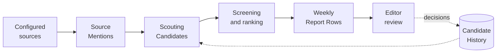

> **Public snapshot.** This copy is generated from a private repository and leaves out the editor's data. See [SNAPSHOT.md](SNAPSHOT.md).

# AutoScout


AutoScout finds foreign adult nonfiction books that may be worth acquiring for a Russian trade publisher, and hands an editor one short list a week with the evidence for every entry.

An acquiring editor has to watch award lists, bestseller charts, curated media lists, reader-interest rankings, audiobook charts, and rights announcements across many countries and languages.
Most of what appears there is irrelevant: fiction, children's books, titles already published in Russian, or books that cannot be published in that market at all.
The scanning is the expensive part, and it is the part that repeats every week.

AutoScout does the scanning.
It collects public signals from configured sources, merges the same book across markets, checks whether a Russian edition already exists, screens for content that is unpublishable in the target market, and produces a ranked, reviewable list.
The editor decides.
Every decision is recorded and changes what the next run shows.

It is in weekly production use with a real editor.

## Quick start

Python 3.12 or later, from a clean checkout:

```bash
pip install -e ".[dev]"

# a full deterministic weekly run against fixtures, no network
python -m autoscout run-mvp --config configs/weekly-mvp-fixture.json --output-dir tmp/demo

# the editor-facing result, one row per book
head -3 tmp/demo/editor-facing.csv
```

The fixture run is offline and deterministic.
It exercises source collection, duplicate merging, signal aggregation, Russian-edition checks, visible-risk labelling, editor history, suppression, priority labelling, and the CSV contract, with no live network access.

## How it works



Six source families can surface a book: awards, bestseller and ranking charts, media and curated lists, reader-interest lists, audiobook rankings, and rights or deal mentions.
General web search cannot: a book enters only when an independent public signal put it there.

Multiple links from one source family count as one Independent Signal.
Several families count as several.
That distinction is what separates a genuinely corroborated book from one that is merely linked a lot.

Editor decisions persist.
A rejected book stays hidden until something material changes, such as a new signal family, a stronger signal, or a change in Russian-edition or risk status.

See [docs/architecture.md](docs/architecture.md) for the layers and design rules, and [GLOSSARY.md](GLOSSARY.md) for the domain vocabulary.

## Engineering

| | |
|---|---|
| Source | about 106,000 lines across 151 modules |
| Tests | about 164,000 lines, 304 files, 14,600 tests, all offline |
| Type checking | mypy across the package |
| Decisions | 21 ADRs in [docs/adr](docs/adr) |

Three things are enforced by the merge gate, `./scripts/check`, which a pre-push hook requires on every task branch and CI runs for pull requests and `main`:

**Determinism.**
The same fixture config run twice produces byte-identical artifacts.
CI generates two independent runs and compares every artifact.
Run it yourself:

```bash
python -m autoscout run-mvp --config configs/weekly-mvp-fixture.json --output-dir /tmp/a
python -m autoscout run-mvp --config configs/weekly-mvp-fixture.json --output-dir /tmp/b
diff -r /tmp/a /tmp/b && echo "identical"
```

**A fully offline suite.**
No test touches the network. Live collection is opt-in, per source, and off by default.

**Lint, format, and types.**
`ruff format --check .`, `ruff check .`, `mypy autoscout/`.

```bash
pip install -e ".[dev]"
ruff format --check . && ruff check . && mypy autoscout/ && pytest tests/
```

Run `./scripts/check` to execute the full CI gate locally, including the CLI smoke checks and fixture artifact-parity checks.

## Commands

```bash
./scripts/help
```

lists every command you can run, grouped by task, with what each one touches: the network, a model, weekly state, or nothing.
It includes the Claude Code slash commands, such as `/scout-sources` for overnight source scouting, which `./scripts/night-scout` runs in Codex.

## Publishing constraints in the target market

AutoScout serves a publisher in Russia, where several subjects cannot legally be published.
The tool therefore screens public metadata for signals of a short list of restricted categories fixed in the configuration.

Two things are deliberate about how this works.

It uses public metadata only, never the book's text, and it never decides anything on its own.
A flagged book stays on the editor's list with a comment and a lower priority label, so a person makes the call with the reason in front of them.
The status `no visible risk` means no configured signal was found in public material.
It is not legal clearance and the tool does not present it as such.
Each row also says whether the screen ran and how completely, so a blank status is never mistaken for a clean one.

This is a constraint of the market the tool serves, recorded here plainly rather than buried in the configuration.

## Documentation

| | |
|---|---|
| [GLOSSARY.md](GLOSSARY.md) | Domain vocabulary; the authority on every capitalised term |
| [docs/architecture.md](docs/architecture.md) | Layers, pipeline path, design rules |
| [docs/cli-reference.md](docs/cli-reference.md) | Every command, artifact, and data contract |
| [docs/adr](docs/adr) | 21 architecture decision records |
| [docs/current-weekly-operator-workflow.md](docs/current-weekly-operator-workflow.md) | Running the weekly workflow |
| [docs/source-onboarding-runbook.md](docs/source-onboarding-runbook.md) | Adding a source |
| [.claude/skills/scout-sources/SKILL.md](.claude/skills/scout-sources/SKILL.md) | Overnight source scouting and onboarding with `/scout-sources` or `./scripts/night-scout` |
| [docs/state-store-cutover-runbook.md](docs/state-store-cutover-runbook.md) | Moving the run server's state to one file per book, then to SQLite (#1077) |
| [docs/nanode-search-adapter-runbook.md](docs/nanode-search-adapter-runbook.md) | Running the grounded search adapter on the Nanode |
| [docs/notes](docs/notes) | Historical planning notes, superseded by the ADRs |

## Status

Weekly production use with one editor.
The source portfolio has 40 active sources in ten languages.

An agent can scout and prepare new sources overnight on request; the operator confirms each one in the morning.
Since 2026-11-10 the weekly scan also runs from a timer on the operator's home server, every night at 02:30 Asia/Jerusalem, with the Kirkus pass at 01:30 (ADR 0021, ADR 0022); the editor can still start a run through her agent, on that server. The timer units are in `deploy/server/`, with install steps in `docs/operator/run-server.md`.
Not built yet: automatic source-health monitoring and a schedule for night scouting.
[PLAN.md](PLAN.md) tracks what works today against what is planned.

## License

Proprietary. All rights reserved.
