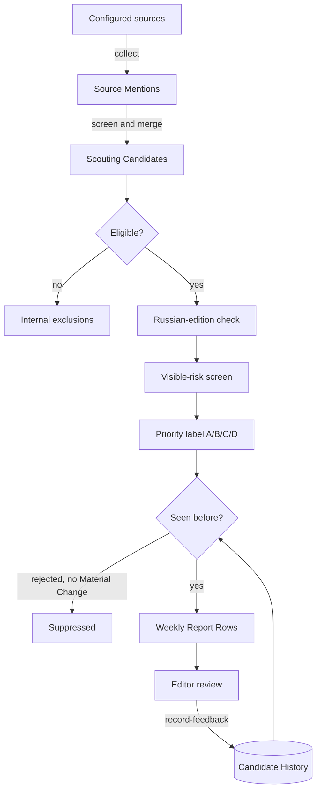

# Architecture

AutoScout turns public book signals into a short, reviewable weekly list.
This document names the layers, the path a book takes through them, and the seams where state is written.
For the command surface see [cli-reference.md](cli-reference.md).
For the domain vocabulary see [GLOSSARY.md](../GLOSSARY.md), which is the authority on every capitalised term below.

## The pipeline path

The loop matters more than the line.
Editor decisions persist in Candidate History, and the next run reads them before it decides what to show.
A rejected candidate stays hidden until a Material Change occurs.

## Layers

**Collection.**
`source_collection`, `source_collectors/`.
Reads only configured sources.
General web search cannot create a Scouting Candidate.
Each collector is bounded: it retains metadata, URLs, and Evidence Notes, never full page bodies.

**Identity and evidence.**
`source_page_identity`, `ranking_*`, `capture_sanitization`, `ranking_evidence`.
Proves a captured page is the page that was declared.
Declared selectors are authoritative and fail closed, so a silent layout change becomes a failed source rather than wrong data.

**Screening.**
`source_eligibility`, `russian_editions`, `visible_risk`, `scoring`, `editorial_taste_profile`.
Decides what reaches the editor and with what priority.

**Reporting.**
`weekly_report`, `review_rendering`, `reporting`.
Produces the editor-facing CSV and the rendered review.

**State.**
`state`, `candidate_history_migration`, `editor_feedback`, `exclusion_history`.
Candidate History is canonical.
Run outputs are derived and disposable; state is not.

**Operations.**
`doctor`, `run_health`, `source_probe`, `source_onboarding*`, `search_optimization*`.
Diagnosis, source onboarding behind a Source Proposal gate, and the read-only ordering trial.

## Design rules

These hold across the codebase and explain choices that would otherwise look strict.

**Deterministic by construction.**
The same fixture config run twice produces byte-identical artifacts.
CI enforces it on every push.
Ordering, digests, and serialization are all stable on purpose.

**Fail closed on evidence.**
A declared contract that cannot be satisfied fails the source.
Wrong data costs the editor more than a missing source does.

**Bounded retention.**
Captures store metadata, URLs, and Evidence Notes.
Full page bodies, article text, and book samples are never retained.
Retention limits are declared per source and enforced at the writer.

**The editor holds authority.**
The tool proposes; a person decides.
Feedback is recorded through a confirmation-gated path, and raw editor notes are preserved verbatim.
See [ADR 0008](adr/0008-editor-authority-agent-informed-consent.md).

**Evidence over scores.**
Priority labels are derived from Independent Signal count, Signal Strength, Publisher Fit, and status fields.
There is no opaque numeric score.

## Decisions

Thirteen decisions are recorded in [docs/adr](adr/).
The ones that shape the architecture most:

| ADR | Decision |
|---|---|
| [0005](adr/0005-configured-source-discovery-only.md) | Only configured sources may discover candidates |
| [0006](adr/0006-agent-extraction-default-collector.md) | Agent extraction is the default collector |
| [0008](adr/0008-editor-authority-agent-informed-consent.md) | The editor holds authority; the agent asks for consent |
| [0009](adr/0009-results-representation-and-feedback-channel.md) | Review happens in an agent session, not a shared spreadsheet |
| [0011](adr/0011-ranking-table-bounded-detail-route.md) | Ranking detail routes are bounded |
